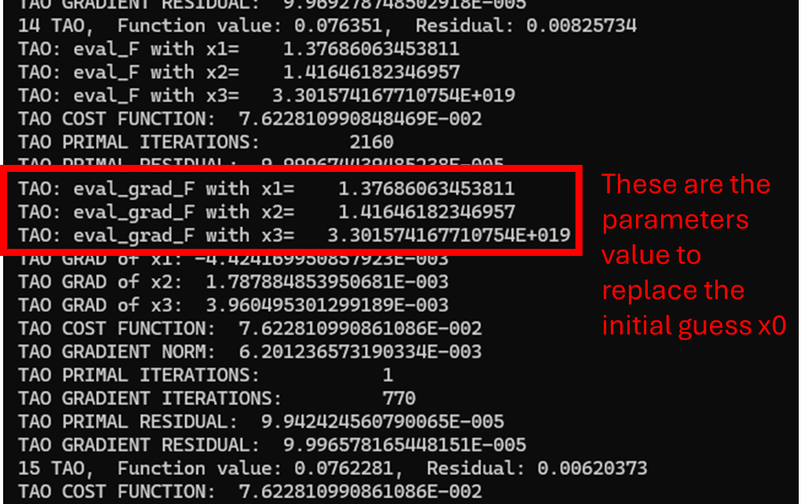
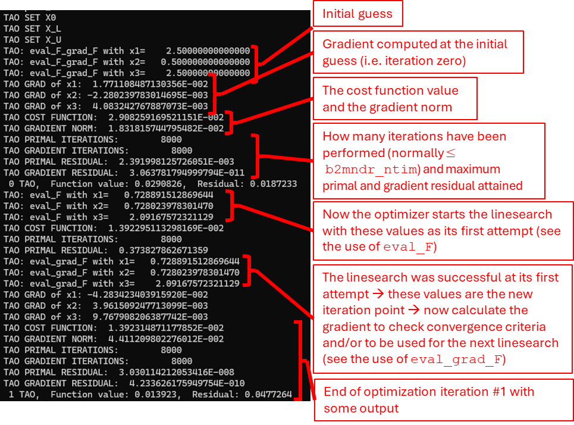
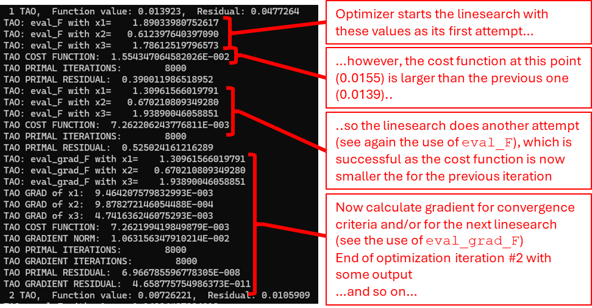
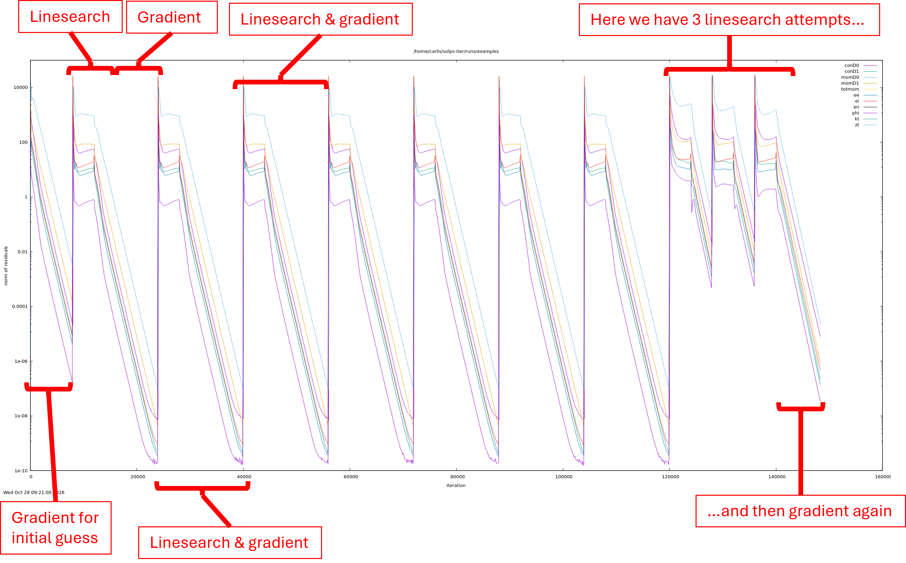
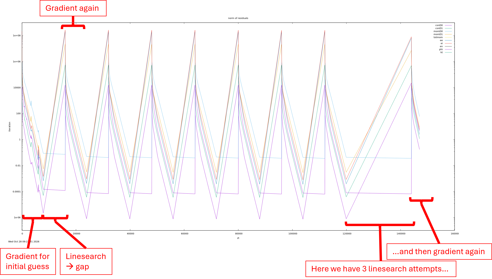
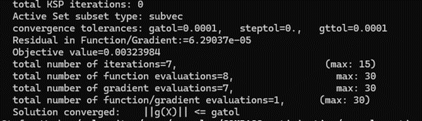
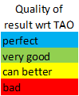
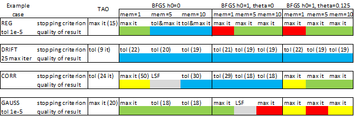

# AD and model calibration

/// warning | This feature blog entry introduces advanced concepts
The reader is assumed to know how its way in the [Wide Grids SOLPS-ITER version](./Wide_grids.md).
///

## What you need to know before starting

- It is only available for the wide-grid version of SOLPS-ITER
- Read the documentation in the [SOLPS-ITER manual](#rtfm), section “Sensitivity calculation and optimization in B2.5”
- The AD code is almost always NOT in sync with the standard B2.5 code. With ‘sync’ I mean that the AD code is built upon a version of B2.5 at a certain commit (where the `feature/ad-wg` branch is). So, if you recently introduced a new feature, or you are interested in a certain bug fix that happened *after* the current `feature/ad-wg` branch, you need to re-differentiate B2.5 to produce a new version of the AD code. To do so, you can try on your own based on the documentation (see "Expert mode for AD" section in the [SOLPS-ITER manual](#rtfm)), and/or you can contact the KU Leuven group or S. Carli for support.
- You cannot use EIRENE, only (advanced) fluid neutrals. What you can do however, is optimize with fluid neutrals and then use the obtained parameters in your EIRENE run. They will likely need some adjustments but at least you don’t start from scratch. Alternatively, you can use the Bayesian optimization approach of S. Soldat (not public yet) [Soldat 2024](https://dspace.cvut.cz/server/api/core/bitstreams/5be84f4a-9029-4f6b-b9f7-b7c3ca2f24eb/content)open_in_new, or the iterative scheme proposed by Antonello Zito (also not public) [Zito 2021](https://iopscience.iop.org/article/10.1088/1361-6587/abfcb6)open_in_new,
- You need to have an already existing case which is converging or converged, i.e. residuals decrease towards machine precision. If your case has high, stagnating residuals, you can probably still use the AD code but be aware that the adjoint mode will likely not work as expected so better use the tangent one.
- At the moment (October 2026), for truly unstructured grids coming from GOAT, the cost function definition needs to be adjusted/verified

What I also suggest to do before doing your own optimization is to read [Carli 2026](https://arxiv.org/abs/2609.27435)open_in_new and try to understand one of the example cases in `$SOLPSTOP/runs/examples/COMPASS_optimization`.

## Tips to setup and run your optimization

The experimental data for the cost function needs to be ‘cut’ so that no points lie outside of the related SOLPS-ITER mesh domain, otherwise the code will stop with error. If you chose to map target quantities to the OMP, this is done using $\psi$ and not the radial coordinate.

Since you already have a converging case, it is recommended that the initial guess `x0` specified in `b2.optimization.parameters` is whatever value you are currently using in your converging case. Setting these values in `b2.optimization.parameters` overwrites said values set in the usual input files (e.g. `b2mn.dat` , `b2.transport.parameters`, etc.).

At the beginning of the optimization, i.e. the first 10-ish optimization iterations, you are likely far from the optimum and as such you don’t need very precise gradients to take a good step towards the optimum. Therefore, you don’t need to fully converge SOLPS to machine precision for each optimization iteration. Later on in the optimization precision matters more and so to reach/fulfill strict optimization convergence tolerances (i.e. gradient being close to zero) you likely need to fully converge SOLPS to get precise gradients and cost function.

Reaching zero gradient is numerically extremely challenging so setting convergence tolerance of $10^{-4} – 10^{-6}$ is reasonable.

## How do I continue an optimization that has not reached convergence?

If the optimization ended successfully because it reached the max number of iterations required, then copy-paste `b2fstate` into `b2fstati`. Then, you’ll need to manually replace the initial guess `x0` in your `b2.optimization.parameters` with whatever parameter value was last printed in `run.log` (see for this documentation on scripts `run_info`, `results_tao.sh`, `result_bfgs.sh`, or use `$grep -i tao run.log`). The picture below shows the result of the command `$grep -i tao run.log` on a possible optimization.

/// warning | Beware!
When you restart your optimization the BFGS matrix and history are emptied, and the gradient (depending on which optimizer and options you are using) is re-normalized using the first gradient computed in the re-started case: this means that even though the gradient may be small in magnitude, the line-search may attempt too large steps, and therefore crash! See below on common pitfalls on how to deal with this.
///

## How to interpret the optimization output printed in `run.log`?

The pics below are the outcome of `$grep -i tao run.log`

## How to interpret residuals plots?

The first figure below is the outcome of `resall_D` on an optimization case for which 8000 B2.5 iterations per optimization iteration are used. B2.5 will write in `b2ftrace` the residuals both when it computes the gradient and when it performs a linesearch attempt. The sudden jumps in the residuals are normal, and are a consequence of the linesearch. 

Take for example the first optimization iteration: 
- the optimizer will first of all compute the gradient with the initial guess $x_0$, and converge for 8000 iterations
- then it will attempt a new value $x_1\neq x_0$, which the current plasma state does not satisfy, hence the jump in residuals. The linesearch also converges for 8000 iterations.
- If the linesearch is successful, then the gradient is computed for the same $x_1$ just attempted, therefore no jumps in the residuals! 

Note for example towards the right of the figure the three linesearch attempts: each of them converges for 8000 iterations, and only the third is successful and allows the gradient computation. This type of plot will be the same when using tangent or adjoint AD.

Turning now to the plot of the residuals of the differentiated equations, the figure below shows the case when using tangent AD, obtained with `resall_D_diff`. The plot refers to the same optimization as above, but is slightly different now, because B2.5 writes this residual information in `b2ftraced` only when the gradient computation routine is called. However, the iteration counter keeps increasing even if the routine is not called, which causes the ‘gaps’ where the last residual of the previous gradient computation is connected with a straight line to the first residual of the new gradient computation. Note how the three linesearch attempts on the right of the figure leave a larger gap.

For adjoint AD one uses instead the `res_adj script`: the figure will show a single line instead of one line for each equation solved and no gaps since the adjoint code writes this information directly in `run.log`.

## How do I know if my optimization was successful?

Do `$tail PETSC-TAO.OUT` after running the script `result_tao.sh`, the outcome is something like the picture below. 

A converged case will show something like this, with convergence being either because of tolerance or maximum iteration count. Failure of the optimization means Line Search Failure. When B2.5 itself crashes with `xerrab` there is no additional output from the optimization.

## Some common pitfalls and suggestions

Commons cause for optimization to crash is that the optimizer attempts too large steps in the linesearch and B2.5 crashes. To deal with these see the [SOLPS-ITER manual](#rtfm), section “Run an optimization” or Appendix A of the paper [Carli 2026](https://arxiv.org/abs/2609.27435)open_in_new: 
- one can typically reduce the maximum step size that the line search will attempt (default is 1) (This feature seems no longer present in more recent versions of PETSc/TAO, e.g. `3.15.1`. One ‘hotfix’ to avoid poorly scaled steps is `-tao_bqnls_mat_lmvm_scale_type NONE`, but this might be undesirable); 
- and/or gradually modify the model parameters from their value at the previous iteration to the new value;
- and/or reset drifts to a lower percentage strength and gradually increase them back to 100%.

Line Search Failure happens when the optimizer, with the current value of the gradient, cannot find a point along the gradient direction wrt which the cost function decreases. This often is caused by incomplete convergence of B2.5, so increasing `b2mndr_ntim` can help.

Also, if your simulation crashed or failed with Line Search Failure, you can still continue it: if you enabled saving the `b2fstate` file after each optimization iteration (see [SOLPS-ITER manual](#rtfm)), then you can pick the last successful optimization step by inspecting `run.log`, using the `b2fstate` saved at that iteration (found in `b2mn.exe.dir`) and copy-pasting into `b2.optimization.parameters` the parameters value at that specific iteration (see above on how to continue an optimization).

/// warning | Beware!
Restarting from the last successful step means, as explained above, that the BFGS matrix and history, and gradient normalization are reinitialized!
///

## Tips to re-differentiate the code

After the code has been re-differentiated and postprocessed (see again [SOLPS-ITER manual](#rtfm)), it is useful to just use the program `meld` to compare the new differentiated code and the old, or the differentiated code produced by Tapenade and the one postprocessed with scripts, to spot where differences appear and possible bugs. Since the differentiation introduces some bugs in the code, these have been automatized in a set of scripts. When differentiating a new B2.5 version some of these automatized bug fixes may fail or may not be sufficient, that is why `meld` comes useful. This was especially the case for routine `b2mod_driver_diff.F90` for adjoint AD, where extensive adjustments to the differentiated code are needed.
The best strategy to follow when re-differentiating the code is:
1. Differentiate in tangent (vector) mode: this is the easiest one, if this doesn’t work, forget about adjoint. Then compare old and new tangent code for possible differences/bugs.
2. Verify correctness of the tangent derivatives against finite differences (FD) (use the provided example case `$SOLPSTOP/runs/examples/COMPASS_sensitivity` and `COMPASS_sensitivity_D+T`). Typical accuracy of AD vs FD which can be obtained is $10^{-5}-10^{-8}$ in relative error (see [Carli 2023](https://www.sciencedirect.com/science/article/abs/pii/S0021999123004989)open_in_new). If one specific parameter gives much lower sensitivity accuracy first check if its relative sensitivity $\frac{\partial \mathcal J}{\partial x_i } \frac{x_i}{\mathcal J}$ (with $\mathcal J$ the cost function and $x_i$ the model parameter) is much smaller compared to the others, if so, then the difference is very likely due to numerical truncation. If not, first check that the FD cases for this specific parameter are correctly setup and converged. If still persists, then there is likely a bug in the tangent code.
3. Verify that the optimization works as before on at least one example case
4. Differentiate in adjoint mode and compare old and new tangent code for possible differences/bugs.
5. Compare adjoint AD vs tangent AD sensitivities: these should reach almost machine precision accuracy $10^{-11}-10^{-14}$. If one specific parameter gives much lower sensitivity accuracy wrt tangent AD then it is likely that there is a bug in the adjoint (or tangent) code.

## Comparison of performance of built-in BFGS method vs PETSc/TAO BFGS method

The following table provides a comparison of the performance of the built-in BFGS method against the default PETSc/TAO (hereafter abbreviated in TAO) BFGS one (PETSc/TAO version `3.20.6`). In the table it is referred to the example cases distributed with SOLPS as:
- REG = `example_optim_reg_dna_hce_necore`
- DRIFT = `example_optim_reg_drift`
- CORR = `example_optim_map_dna_sigma_corr`
- GAUSS = `example_optim_map_dna_hce_gauss_prior`

If under a specific example case you see `tol = 1e-5` it means that for the built-in BFGS it was needed to lower the optimization convergence tolerance from `1e-4` to `1e-5` to obtain decent results (TAO still uses `1e-4`). Similarly, if you see `25 max iter` it means that the maximum number of optimization iterations allowed was increased for the built-in BFGS to obtain decent results. The other quantities should be self-explanatory: h0 = `lbfgs_h0_type`, theta  = `lbfgs_theta`; mem = `lbfgs_memsize`; max it = stopped because the maximum number of optimization iterations was reached; tol = stopped because one of the optimization convergence tolerances was met (doesn’t matter which one); LSF = Line Search Failure. The number between parenthesis indicate the number of optimization iterations needed to reach that specific result.

Color coding for *quality of result* i.e. how the built-in BFGS result compares against that of TAO (and of the synthetic data, since TAO is already pretty good).

So overall, one can see that TAO performs better than the built-in BFGS one, both in terms of quality of result and also in iterations required to reach that result. The only exception is for example case GAUSS with h0=1, theta=0 and memsize=5/10, for which the built-in BFGS converges in 18 iterations wihile TAO in 24. Also, one can see that the best parameter set for the built-in BFGS is quite case-dependent. Overall, if using the built-in BFGS the scalar scaling version (`lbfgs_h0_type=0`) with larger memory (`lbfgs_memsize=10`) sems to give more consistent and better results compared to diagonal scaling `lbfgs_h0_type=1`, so these are set as default parameters until otherwise proven.
