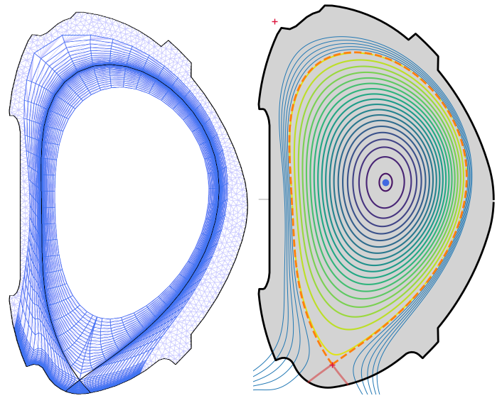
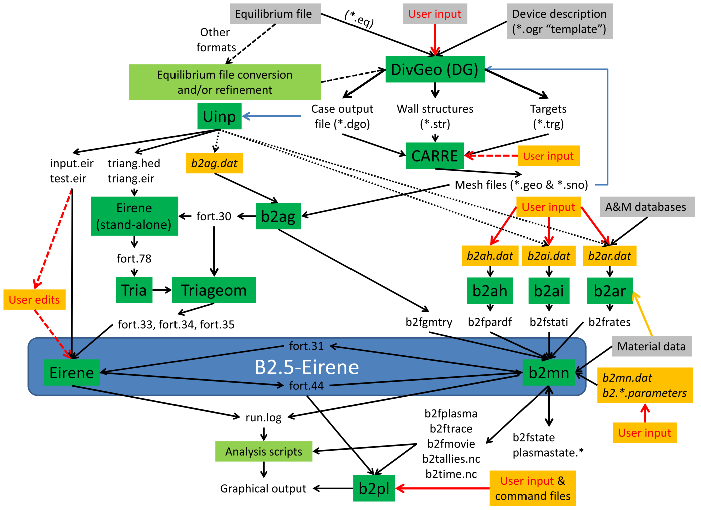

# Introduction

Welcome to **SOLPS Tutorials**, home to step-by-step guides on using the [SOLPS-ITER](https://github.com/iterorganization/SOLPS-ITER)open_in_new transport code! Accessible documentation for beginners is our goal. As the main author, Kateřina Hromasová, says:
> "I want tutorials that are so easy to understand that I'll be able to use them out of the box after I come back from a three-year maternity leave."

The SOLPS Tutorials [webpage](https://solps-tutorials.readthedocs.io/) is compiled using [MkDocs](https://www.mkdocs.org/)open_in_new from its source code, hosted on the [ITER Organisation GitHub](https://github.com/iterorganization/SOLPS-Tutorials)open_in_new. If you wish to contribute, read the [Contribute](Contribute.md) tutorial.

*SOLPS Tutorials logo: a supra-luminal unicorn ([why?](supplementary/SOLPS-ITER_user_wisdom.md#unicorn))*

## Navigating the tutorials

SOLPS Tutorials are sorted into three basic categories parts:

1. **My first SOLPS simulation**. This includes [installing SOLPS](installing/solps-iter-codebase.md), [creating a simulation](my_first_simulation/Creating_a_new_SOLPS-ITER_simulation.md), [running the simulation](my_first_simulation/Running_SOLPS-ITER.md), [processing its output](my_first_simulation/Processing_SOLPS-ITER_output.md) and [adjusting its input](my_first_simulation/Adjusting_SOLPS-ITER_input.md).

2. **Feature blog**, or making your SOLPS simulation more complex. This includes [diffusion coefficients](feature_blog/Diffusion_coefficients.md), [gas puffing and pumping](feature_blog/Gas_puffing_and_pumping.md), [impurities](feature_blog/Impurities.md), [drifts](feature_blog/Drifts.md), [wide grids](feature_blog/Wide_grids.md), [algorithmic differentiation and model calibration](feature_blog/AD_and_model_calibration.md), and deep dives on [magnetic equilibrium reconstructions](feature_blog/Magnetic_equilibrium_reconstructions.md), [energy fluxes](feature_blog/Energy_fluxes_deep_dive.md) and [interpretative simulations](feature_blog/Interpretative_simulations_of_COMPASS.md).

3. **Supplementary material**, which helps you use SOLPS aside from the physics. This includes [SOLPS-ITER user wisdom](supplementary/SOLPS-ITER_user_wisdom.md), a [library](supplementary/Library.md), [remote access](supplementary/Remote_access.md), [common pitfalls](supplementary/Common_pitfalls.md), [questions and answers](supplementary/Questions_and_answers.md) and [B2.5 switch documentation](/extras/b2input).

When contributing to the tutorials, please respect this underlying structure.

/// tip | Your documentation could be here!
Although SOLPS Tutorials do not aim to substitute existing SOLPS documentation, they do aspire to become its central hub. If you have written any sort of SOLPS-related documentation, consider [contributing to SOLPS Tutorials](Contribute.md) or adding your work to the [Useful links](supplementary/SOLPS-ITER_user_wisdom.md#useful-links) section.
///

## First steps

To familiarise yourself with SOLPS-ITER and SOLPS Tutorials, you can do the following:

- To learn what SOLPS-ITER is and what it's for, read the [introduction to SOLPS-ITER](#brief_introduction) and skim the references therein.

- To become familiar with SOLPS-ITER jargon, skim [SOLPS-ITER user wisdom](supplementary/SOLPS-ITER_user_wisdom.md), particularly the [Dictionary](supplementary/SOLPS-ITER_user_wisdom.md#dictionary).

- If you need to run SOLPS on a remote server (like the [EUROfusion Gateway](installing/solps-iter-codebase.md#eurofusion_gateway)), read up on the [basic techniques](supplementary/Remote_access.md#basic-techniques) of remote access.

- [Install SOLPS-ITER](installing/solps-iter-codebase.md). Or better yet, use the portable [container installation](installing/installing-in-container.md).

- [Create your first SOLPS-ITER simulation](my_first_simulation/Creating_a_new_SOLPS-ITER_simulation.md). Then continue down the list of tutorials on the left in the section *My first SOLPS-ITER simulation*.

- When faced with problems, try the search bar on the top right, [Questions and answers](supplementary/Questions_and_answers.md) or [Common pitfalls](supplementary/Common_pitfalls.md).

## Introduction to SOLPS-ITER

/// tip | SOLPS-ITER in a nutshell
SOLPS-ITER is a suite of codes (B2.5, EIRENE, DivGeo, Carre...) which performs 2D (toroidally symmetric) simulations of the tokamak edge plasma. Its strength lies in self-consistently modelling interaction between the plasma, neutrals and the wall. It is indispensable for predicting if future tokamak fusion reactors will melt their divertors or not.
///

**SOLPS-ITER** is the newest version of the SOLPS (Scrape-Off Layer Plasma Simulator) code package. It is one of the most sophisticated tools for numerical modelling of plasma in the tokamak edge (= Scrape-Off Layer + a narrow bit of confined plasma). SOLPS has been widely used for both **interpretative** simulations (recreating experimental plasmas as faithfully as possible) and **predictive** simulations (predicting experiments that haven't been performed yet). It has been used to model tokamaks such as ASDEX Upgrade, JET, Alcator C-Mod and DIII-D, and it is the most employed tool to predict the edge performance of future fusion reactors such as ITER.

*Left: Typical simulation region of SOLPS-ITER (narrow grids version). Blue = B2.5 grid, lavender = EIRENE grid. Right: Underlying magnetic equilibrium. COMPASS tokamak.*

/// hint | SOLPS-ITER house rules
The SOLPS-ITER source code is distributed via a [Git repository](https://github.com/iterorganization/SOLPS-ITER)open_in_new maintained by the ITER Organisation. Because the package is available to a wide variety of users operating in different computing environments, the source code must adhere to strict FORTRAN and C standards and the compilation files must allow for this diversity. This is achieved by determining, at session start-up, the current location (with the `whereami` script) and compiler choice and setting up environment variables accordingly.
///

### Coupling B2.5 with EIRENE

At the heart of SOLPS-ITER lies the **coupling of two codes**: the 2D multi-fluid plasma transport code [**B2.5**](#b25) (which models the electrically charged part of a plasma) and the 3D kinetic Monte Carlo neutral transport code [**EIRENE**](#eirene) (which models the electrically neutral part of a plasma). [Historically](supplementary/Library.md#evolution-of-solps), there have been many implementations of the SOLPS code package, according to which version of the fluid plasma code (B2 or B2.5) and of the EIRENE code were used. We distinguish between SOLPS 4.x (which uses B2), and SOLPS 5.x (which uses B2.5). SOLPS-ITER contains the B2.5 plasma kernel and the most recent version of EIRENE.

/// hint | SOLPS-ITER: coupled mode vs standalone mode
Although SOLPS-ITER is primarily a coupling between B2.5 and EIRENE, it can also be run without EIRENE and solve neutrals as a neutral fluid using B2.5. Such simulations are called "standalone" (only B2.5), as opposed to "coupled" (B2.5 with EIRENE). The main advantages of standalone simulations are that they converge (produce results) faster and avoid the typical Monte Carlo statistical noise. The disadvantage is that the simulation results are less accurate. In practice, one may start with a standalone simulation, reach some intermediate plasma solution, and then turn on EIRENE to obtain the final, accurate solution.
///

The coupling between B2.5 and EIRENE works this way:

1. A plasma background prepared by B2.5 is sent to EIRENE. This "background" includes 2D maps of all fluid parameters of the plasma: density of individual ion species, their parallel velocities, ion and electron temperature, plasma potential, and others.

2. EIRENE launches a number of neutral particles across this plasma background and follows what happens to them. They may be ionised, they may be excited, they may undergo charge exchange, they may scatter elastically off another neutral particle, et cetera. EIRENE tallies up the results for each cell of the computational region.

3. The calculated neutrals solution is passed from EIRENE back to B2.5. It includes primarily 2D maps of sources/sinks of plasma particles, momentum and energy created by plasma-neutral interactions, on top of neutral atom densities, neutral molecule densities etc.

4. B2.5 re-computes the plasma solution based on this neutral background. Typically, it performs 10-15 *internal iterations* on top of the temporarily static neutrals solution. This makes convergence faster.

5. One *external iteration* of B2.5-EIRENE has now been completed. If the user requested so, the simulation can stop. Alternatively, it will return to step 1 and keep on running.

### B2.5

/// hint | On the name B2.5
With the common naming conventions of plasma simulation codes, you might expect that "B" stands for "Braginskii equations solver" and "2.5" means "2.5-dimensional". Reality is much funnier.

The ".5" part of B2.5 comes from 1996, when the original code B2 was upgraded to model neutral fluids and solve the potential equation. [[Brams 1996]](https://onlinelibrary.wiley.com/doi/epdf/10.1002/ctpp.2150360233)open_in_new The name was supposed to reflect the big upgrade, so B2.1 was skipped in favour of B2.5. There is even talk of "B3" in the future, but that won't mean transition to 3D. (If you want a 3D tokamak transport code, don't put your hopes in the B2 line and use [EMC3-EIRENE](https://iopscience.iop.org/article/10.1088/1741-4326/aad42f/meta)open_in_new instead.)

What does "B2" mean, then? Well, firstly, it should be read as "B squared" or "B B" rather than "B two", because, according to legend, it stands for the initials of its original author, Bas Braams. It wasn't named after the equations it solves. It's "Braams squared, baby". Considering we're still using it 40 years later, I can't even be mad at the sheer hubris.
///

**B2.5** is a finite-volume code which simulates tokamak edge plasmas as a mix of fluids. In 2020, it comprised about 90,000 lines of FORTRAN 90 code. In the SOLPS-ITER source code, B2.5 is located in `$SOLPSTOP/modules/B2.5`.

B2.5 solves **modified Braginskii equations** on a discretised, curvilinear grid. You may have studied the [Braginskii equations](https://static.ias.edu/pitp/2016/sites/pitp/files/braginskii_1965-1.pdf)open_in_new in your basic plasma physics theory course. They are derived by taking three velocity moments of the kinetic equation. They consist of:

| Equation name       | Law of conservation for... | In SOLPS-ITER, solves for... | 
| ---                 | ---               | --- |
| continuity equation | particles         | ion densities $n_a$, where $a$ is the ion species |
| equation of motion  | parallel momentum | parallel plasma velocities $u_a$, where $a$ is the ion species |
| energy equation     | energy            | electron and ion temperature $T_e$ and $T_i$ |
| closure expressions | -                 | express all other plasma parameters (heat fluxes, source terms...) with $n_a$, $u_a$, $T_e$ and $T_i$ (and $\Phi$) |

We say B2.5 solves *modified* Braginskii equations because Braginskii wrote his equations for a fully ionised plasma with only one ion species. B2.5 includes a continuity and a momentum equation independently for each resolved ion species (D1+, He1+, He2+ etc.), and solves the potential equation (parallel Ohm's law) to boot. Also it can solve for neutrals as an additional fluid "ion species".

All equations of B2.5 have the form of conservation laws:

> *(time change of a quantity in a cell) + (fluxes of the quantity from/to neighbouring cells) = (sources/sinks of the quantity within this cell)*.

Solving these equations means:

1. Computing the various sources/sinks in each cell. For example, ionisation is a source of charged particles and a sink of neutral particles. In coupled simulations, the sources related to plasma-neutrals interaction is directly passed from the previous EIRENE run. Boundary conditions are also typical sources; for example, the sheath is a source of parallel momentum because it accelerates ions to the sound speed.
2. Calculating the fluxes inbetween cells.
3. Updating the main plasma parameters ($n_a$, $u_a$, $T_e$, $T_i$, $\Phi$) in each cell.

/// hint | Further resources
To understand the equations of B2.5 is to understand transport in the tokamak edge plasma. You can conceivably treat EIRENE as a black box, but you won't get far if you don't study the plasma transport equations. To learn more about the B2.5 equations, refer to:

- Appendix B of Antonello Zito's [PhD thesis](https://www.researchgate.net/publication/376610776_Experimental_and_numerical_investigation_of_helium_exhaust_at_the_ASDEX_Upgrade_tokamak_with_full-tungsten_wall)open_in_new (2023) - explains the B2.5 equations in detail
- Appendix C of the [SOLPS manual](supplementary/Library.md#solps-manual) - lists the whole equations of B2.5 without any simplification but provides minimal comment
- [Implementation and numerics details](supplementary/Library.md#implementation-and-numerics-details) section of the Library
///

### EIRENE

/// hint | On the name EIRENE
The EIRENE code was named after the Greek goddess of peace Eirene. Since the name isn't an acronym, it is sometimes typeset as Eirene.

There is some disagreement whether to pronounce the name as [ai-reen-ee] or [ai-reen]. The former is more proper to the original Greek pronunciation, the latter is shorter. Take your pick.
///

**EIRENE** [[Reiter 2005]](https://www.tandfonline.com/doi/abs/10.13182/FST47-172)open_in_new is a Monte Carlo kinetic code for neutrals transport. It's fully 3D, but within SOLPS-ITER everything is toroidally symmetric, so the 3D capabilities of the neutrals solver are somewhat wasted. In 2020, it comprised about 105,000 lines of FORTRAN 90 code. In the SOLPS-ITER source code, EIRENE is located in `$SOLPSTOP/modules/Eirene`.

EIRENE works by launching a great number of **Monte Carlo test particles**, with a particular distribution of directions and velocities, on top of a static plasma background. It then solves kinetic transport equations and follows what happens to each test particle. A number of events (ionisation, excitation, charge exchange...) can happen along its trajectory, with probabilities determined by the respective cross-sections. Rate coefficients for the atomic processes are provided by databases such as [AMJUEL](https://www.eirene.de/old_eirene/html/amjuel.html)open_in_new and [HYDHEL](https://eirene.de/old_eirene/html/hydhel.html)open_in_new. The lengths of the trajectories are randomly generated from a distribution given by the mean free path. Each test particle is followed until it is either absorbed or ionised. When a given number of particle histories has been generated, EIRENE tallies up and averages the results for each cell. (In EIRENE, the cells form curved tetrahedrals. But in the poloidal projection, they just look like triangles.)

For the purposes of B2.5-EIRENE coupling, EIRENE outputs primarily sources/sinks for each equation B2.5 solves. In general, however, it can output any quantity resolved by the underlying kinetic simulation, like [energy spectra of neutrals](my_first_simulation/Processing_SOLPS-ITER_output.md#eirene-neutral-spectrum) impinging on the first wall or the flux of particles sputtered from the plasma-facing components.

In a SOLPS-ITER simulation, EIRENE is controlled by one giant input file, called `input.dat` or `eirene.input.json` depending on its formatting. The input data include vessel geometry, grid and atomic/molecular data.

The version of EIRENE included in SOLPS-ITER is **parallelizable**, since its test particle histories are independent of each other. In consequence, coupled runs (unlike standalone runs) can be run with parallel computing schemes.  

### Computational grids

SOLPS-ITER uses two (partially overlapping) grids for its simulations.

- The **B2.5 grid** consists mostly of quadrilaterals (four-sided polygons) and has the special property that it is aligned with the magnetic field. This allows the fundamental trick of B2.5 - numerically separating transport along magnetic field lines and across them. Therefore, to generate the B2.5 grid, you'll need a file containing a tokamak magnetic equilibrium (typically in the EQDSK format). SOLPS-ITER contains two codes for generating B2.5 grids: **Carre** to make "structured grids" and **Carre2** to make "unstructured grids" (which can include other than four-sided cells). In the near future, it will also contain the GOAT code for making unstructured grids.
- The **EIRENE grid** consists of triangles. Where it overlaps with the B2.5 grid, it simply cuts the quadrilaters in half. In regions not covered by the B2.5 grid (see [above](#grid_example)), the EIRENE grid is triangulated independently. SOLPS-ITER generated EIRENE grids using the **Triang** code.

[Setting up a SOLPS-ITER simulation](my_first_simulation/Creating_a_new_SOLPS-ITER_simulation.md) is, in a large part, setting up these two grids. A bad grid can make or break a simulation, especially in the [Wide Grids](feature_blog/Wide_grids.md) version of SOLPS-ITER. The process of building SOLPS-ITER computational grids involves the following SOLPS-ITER sub-codes:

1. **DivGeo** (DG, "divertor geometry") is a graphical tool for setting up the general simulation geometry. It was originally written with about 35,000 lines of C code. As principal input, it needs an [$R$, $Z$] outline of plasma-facing components in the tokamak poloidal cross-section and a magnetic equilibrium file. Based on these inputs, it allows the user to specify a number of geometrical properties, like where the gas puff valves are located, what material the divertor targets are made of, or how far into the confined region the Carre grid should extend. Finally, it creates output files which are used for grid generation.

2. **Carre** is a command line programme which generates structured B2.5 grids. **Carre2** works similarly, but generated unstructured grids. As of 2020, Carre consisted of about 20,000 lines of FORTRAN 77 code. Both versions of Carre use the output files created by DivGeo to generate a B2.5 curvilinear grid. In a structured B2.5 grid, numerical calculations are performed on a grid which is topologically rectangular. Transformation between the physical geometry and the computational grid is provided through so-called *metric coefficients*. These are included in the output of Carre. 

3. **Uinp** ("user input") is a command line programme run between Carre and Triang. It automatically produces intermediate and final input files.

4. **Triang** ("triangulation") is a command line programme which generates EIRENE meshes. It uses Uinp and Carre outputs to create a mesh which partially overlaps with the B2.5 mesh.

*Simplified scheme of SOLPS-ITER including its submodules and the input/output files they use to communicate. It looks super complicated, and it is. It will grow on you once you've made a simulation or two.*

/// hint | Grid resolution
The more cells a SOLPS-ITER grid has, the longer the computation takes. However, a grid with too few cells will introduce spatial discretisation errors into the simulation. Essentially, the simulation may converge, but the solution won't be correct. A typical example are peak divertor target heat loads. If your radial grid resolution is too low (flux surfaces too far away), you won't resolve the peak shape and the predicted peak heat load will be lower than in experiment. If your poloidal grid resolution is too low (cells above the target are too big), you won't resolve the plasma-neutral-surface interaction happening just above the target and your degree of detachment will be wrong.

In general, grid resolution should be higher where strong gradients in plasma parameters are expected. SOLPS-ITER grids typically are typically highly resolved poloidally close to the targets (to capture plasma-surface interaction) and radially around the separatrix (to capture the exponential fall in SOL plasma parameters). The X-point is a tough one, because it's a region of large flux expansion (flux surfaces are far from each other) and the B2.5 grid naturally tends toward huge cells. But the X-point is also the region of X-point radiators, MARFE's and other physics you may need to resolve. Experiment, compromise, and most importantly: **Make scans in grid resolution and don't publish anything that distorts the simulation results compared to the highest resolution.**
///

### Reading materials

**Essential SOLPS-ITER reading**:

- [[Wiesen 2015]](http://dx.doi.org/10.1016/j.jnucmat.2014.10.012)open_in_new - cite this under any SOLPS-ITER results
- [[Reiter 2005]](https://www.tandfonline.com/doi/abs/10.13182/FST47-172)open_in_new - [acknowledge this](https://eirene.de/cgi-bin/eirene/login.cgi)open_in_new under any EIRENE results
- [[Bonnin 2016]](https://doi.org/10.1585/pfr.11.1403102)open_in_new - recommended to cite under any SOLPS-ITER results

**Recommended SOLPS-ITER reading**:

- [[Schneider 2006]](https://onlinelibrary.wiley.com/doi/abs/10.1002/ctpp.200610001)open_in_new - old but gentle and extensive review article
- [[Braginskii 1965]](https://static.ias.edu/pitp/2016/sites/pitp/files/braginskii_1965-1.pdf)open_in_new - Braginskii equations are the beating heart of SOLPS-ITER
- [PhD thesis](https://www.researchgate.net/publication/376610776_Experimental_and_numerical_investigation_of_helium_exhaust_at_the_ASDEX_Upgrade_tokamak_with_full-tungsten_wall)open_in_new of Antonello Zito - appendix B goes to great lengths to explain the SOLPS-ITER physics model and equations
- [PhD thesis](files/Hromasova_PhD_thesis.pdf)download of Kateřina Hromasová - construction, meaning and validity of the Braginskii equations

## Contributors

/// hint | Kateřina Hromasová 

*"If I don't write it down, I'll forget it."*

Katka was two years into her PhD on SOLPS-ITER when she got married, agreed on three kids, and realised she'd better get started. To avoid forgetting everything, she began writing down all she knew. She shared her notes with her colleagues, got help putting them up on the internet, realised people outside IPP Prague actually read them, rewrote them to pretend she was a professional... and that's how SOLPS Tutorials were born.
///

/// hint | Jan Hečko 
*"The smaller and easier a task is, the lower it is on my to-do list."*

Honza has awesome superpowers, such as being one with the source code. He is responsible for the [installation tutorials](installing/solps-iter-codebase.md), the [B2.5 switch documentation](/extras/b2input) and the website formatting. He also wrote most of the [Gas puffing and pumping](feature_blog/Gas_puffing_and_pumping.md) and [Drifts](feature_blog/Drifts.md) tutorials, and he got the [Wide grids](feature_blog/Wide_grids.md) tutorial started.
///

Other major contributors to the Tutorials are:

- **Aleš Podolník**  - wrote the [Energy fluxes deep dive](feature_blog/Energy_fluxes_deep_dive.md)
<!---
- **Stefano Carli**  - wrote the [AD and model calibration](feature_blog/AD_and_model_calibration.md) tutorial
--->

We would also like to thank, in alphabetic order, Xavier Bonnin, Irina Borodkina, David Coster, Lukáš Kripner, Jakub Seidl, Sjoerd Reinhoudt, Oleg Shyshkin, Daniel Švorc, Matěj Tomeš, David Tskhakaya, Sven Wiesen and Antonello Zito.
